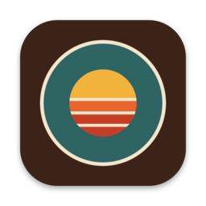
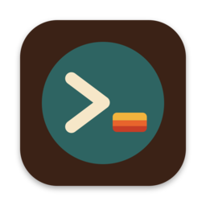
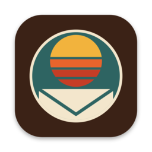

<p align="center">
  
</p>

<h1 align="center">Moonframe</h1>

<p align="center">
  Native desktop apps you, or an agent, reshape while they run.
</p>

<p align="center">
  <a href="https://moonframe.dev"><b>moonframe.dev</b></a> ·
  <a href="https://docs.moonframe.dev"><b>Documentation</b></a> ·
  <a href="https://github.com/penso/moonframe">Source</a>
</p>

Moonframe is a factory for native desktop apps. Each app's whole window is
written in [Luau](https://luau.org), and Rust and [GPUI](https://www.gpui.rs)
draw it, check it and keep it safe. Every panel, split, toolbar and status
bar is a Luau file that reloads as you save, with its state kept, so a change
shows up in the running app in front of you. Ask a coding agent for one, even
from inside the app with its **Send feedback** button, or make it by hand.

## Projects

<table>
  <tr>
    <td width="96" valign="top"><a href="https://github.com/penso/moonframe"></a></td>
    <td valign="top">
      <b><a href="https://github.com/penso/moonframe">Moonframe</a></b><br>
      The library and starter app: a window laid out by Luau, live reload, over 140 components, themes, terminals, providers for data Luau can't reach, packages from git, and whole apps as profiles or standalone releases.
    </td>
  </tr>
  <tr>
    <td width="96" valign="top"><a href="https://github.com/moonframehq/moonmux"></a></td>
    <td valign="top">
      <b><a href="https://github.com/moonframehq/moonmux">Moonmux</a></b><br>
      A workspace for terminals and coding agents: spaces, tabs and split panes, an agents sidebar that tells you who needs you, alerts, Files and Changes panels. Its terminals run in herdr-core or tmux, so every shell and agent keeps running when the window closes.
    </td>
  </tr>
  <tr>
    <td width="96" valign="top"><a href="https://github.com/penso/msgvault-moonframe"></a></td>
    <td valign="top">
      <b><a href="https://github.com/penso/msgvault-moonframe">msgvault</a></b><br>
      A native reader for <a href="https://github.com/wesm/msgvault">msgvault</a> mail archives, its whole window laid out in Luau on Moonframe.
    </td>
  </tr>
</table>

## Build your own

```sh
moonframe init ~/code/my-app    # a new app on the Moonframe library
moonframe app new ~/code/my-app # or a whole app that runs as a profile
```

See [moonframe.dev](https://moonframe.dev) to get started.
